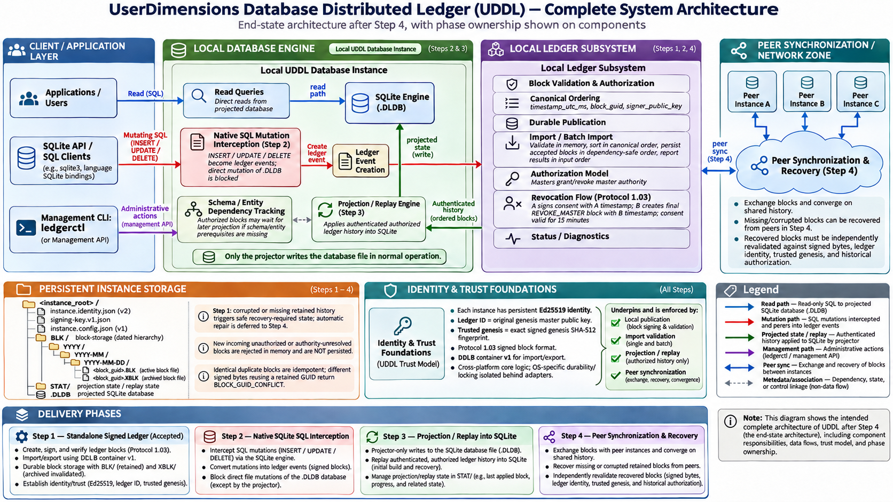

# Database Distributed Ledger

An MIT-licensed open-source distributed signed ledger that derives relational state from immutable authenticated history. **The ledger is authoritative; SQLite `.DLDB` is a rebuildable projection.** Independent masters publish offline, and replicas may verify/relay blocks.

**Status (2026-11-18; Step 1 final Security clearance):** **Step 1 — Standalone Signed Ledger: ACCEPTED AND CLOSED** on Windows 11 at the exact production commit recorded below. Step 2 — Native SQLite SQL Interception is **ready for planning and separate implementation authorization**; no Step 2 implementation is authorized by this documentation update. Steps 3–4 remain deferred. This is not a claim that the full SQLite-integrated distributed database has been implemented or released. Baseline: internally maintained **SQLite 3.54.1** fork with official upstream source provenance in the SQLite architecture plan; C#/.NET 10 application components. PostgreSQL/AI-task adapter obligations are historical. **Owner-approved signed-block protocol: 1.03 (`0x0103`)** with the 32-byte genesis-key ledger ID, exact 165-byte `DDL-REVOKE-v3` consent, and Version 2 identity manifest. Historical 1.01 (`0x0101`) and 1.00 (`0x0001`) are incompatible; no released historical ledger migration is required.

## System Architecture


Editable diagram source: [diagrams.net (.drawio)](docs/diagrams/UDDL_Complete_System_Architecture.drawio).

**Database write and read lifecycle:** [View the lifecycle diagram](docs/diagrams/UDDL_Database_Write_Read_Lifecycle.png) — how SELECT reads projected SQLite state, SQL mutations become signed ledger events, and the Step 3 projector alone writes `.DLDB`. Steps 2–4 are planned, not implemented. Editable diagram source: [diagrams.net (.drawio)](docs/diagrams/UDDL_Database_Write_Read_Lifecycle.drawio).

**Multi-master synchronization (planned Step 4):** [View diagram](docs/diagrams/UDDL_Multi_Master_Synchronization.png) — offline masters, peer block exchange, TREE.HASH comparison, independent validation and eventual convergence. Editable diagram source: [diagrams.net (.drawio)](docs/diagrams/UDDL_Multi_Master_Synchronization.drawio).

**Ledger authorization lifecycle:** [View diagram](docs/diagrams/UDDL_Ledger_Authorization_Lifecycle.png) — genesis establishes the first master, grants add authority, two-signature revocations remove it, and late-arriving historical blocks can change local authorization classifications. Editable diagram source: [diagrams.net (.drawio)](docs/diagrams/UDDL_Ledger_Authorization_Lifecycle.drawio).

**Block validation and storage lifecycle:** [View diagram](docs/diagrams/UDDL_Block_Validation_Storage_Lifecycle.png) — in-memory validation, canonical batch admission, durable `.BLK` storage, later `.XBLK` archival, and recovery boundaries. Editable diagram source: [diagrams.net (.drawio)](docs/diagrams/UDDL_Block_Validation_Storage_Lifecycle.drawio).

## Project milestone and acceptance record — 2026-11-18

| Field | Accepted record |
| --- | --- |
| **Step 1 status** | **ACCEPTED AND CLOSED** — Standalone Signed Ledger |
| **Accepted production commit** | `fbb38781faa29eb5cead9de3dcda0e760b63c7a1` |
| **Independent QA evidence commit** | `70d4d77888bdf869925da7193d8ca44e01d93dd7` |
| **QA-016 final** | **READY** — 52 candidate PASS, 6 source PASS, 76 reference PASS, 0 failures/blockers; 331 validated receipts |
| **Formal dispositions** | Architect **READY**; Developer **READY**; QA **READY**; Owner **ACCEPTED**; Security **READY** (final formal disposition; no outstanding Step 1 Security issues) |
| **Initial qualification scope** | Windows 11; Linux/macOS portability remains required by design, not yet independently qualified |
| **Next phase** | **Step 2 — Native SQLite SQL Interception**, ready for planning; implementation **not authorized** until a separate PM/Owner directive |

**Accepted qualifications, not unexecuted blockers:** FI-07/FI-15 use Owner-approved observable pre/post/ERROR replacement checks (11 PASS, 0 FAIL reported in QA-012); their original unobservable OS-internal checkpoints remain **REPLACED/UNEXECUTED**, never retroactively marked PASS. `FI09-LIVE-RESULT-SNAPSHOT` is **NOT OBSERVED — OWNER-APPROVED EQUIVALENT EVIDENCE** using the accepted paired observations; no invented literal-snapshot PASS. These results do not establish actual physical-power-loss durability or qualification of other operating systems. Automatic recovery of missing/corrupted signed history from peers is **Step 4**, not a Step 1 acceptance condition. Preserve all historical QA reports and their limitations; the accepted SHA and QA evidence SHA above are the exact milestone baseline for later regressions.

**Security closure record:** At the time of Owner acceptance, the formal Security disposition was still pending; Security subsequently issued final **READY** for the same accepted production commit. Step 1 is now **ACCEPTED AND CLOSED** with Architect, Developer, QA, Security and Owner responsibilities complete. This does not authorize Step 2 implementation.

## Documentation ownership and maintenance

To prevent duplicate or conflicting "latest override" paragraphs, keep **one normative location** for each contract: the [Technical Design](Database_Distributed_Ledger_Technical_Design.md) owns signed bytes, authorization and canonical replay; the [Management API](Distributed_Ledger_Management_API_Specification.md) owns CLI/JSON/errors; the [SQLite Plan](SQLite_Architecture_and_Implementation_Plan.md) owns filesystem/VFS/SQLite integration and qualification. This README is an overview, **not** a second protocol specification. Update the operative section in place when an Owner approval supersedes it; retain historical context only when clearly labeled historical. Cross-references do not weaken authoritative technical requirements.

## Authoritative documents

- [Technical design](Database_Distributed_Ledger_Technical_Design.md) — Owner-approved 1.03 signed envelope and five-class value/event schema, genesis/authorization, canonical order, replay, conflicts.
- [SQLite architecture and implementation plan](SQLite_Architecture_and_Implementation_Plan.md) — native SQL interception, identity, files, replay, projection and phases.
- [Management API specification](Distributed_Ledger_Management_API_Specification.md) — Phase 1 management commands, JSON/error conventions, recovery and durability.
- [MIT license](LICENSE) — original project license; preserve SQLite upstream public-domain provenance and all third-party notices.

Existing `.docx` files are **historical and not synchronized** with current Markdown documents.

## Developer implementation guides

- [Step 1 implementation diagrams](docs/development/STEP1_IMPLEMENTATION_DIAGRAMS.md) — source-backed code organization, publication/import, identity/trust, authorization, storage and recovery. Distinguishes accepted baseline `fbb3878` from its QA-verified, Owner-authorized maintenance successor `83cbcb5` and separates implemented behavior from later phases; this is not a second protocol specification.
- [Step 1 follow-up integration record](docs/development/STEP1_FOLLOWUP_INTEGRATION_20261118.md) — maintenance authorization, QA-017 evidence and preservation of the original accepted milestone.

## Identity and storage

```text
ABC.DLDB                              # SQLite derived projection; absent in ledger-only Phase 1
ABC/                                  # support folder derived from database basename
    instance.identity.json            # approved Version 2; stable instance GUID, 32-byte ledger ID + exact genesis SHA-512 pin
    signing-key.v1.json               # Version 1 AES-256-GCM-obfuscated Ed25519 seed
    instance.config.json              # optional Version 1 persisted resource limits
    BLK/YYYY/YYYYMM/YYYYMMDD/         # validated raw signed blocks, exact bytes
    BLK/OUTOFRANGE/                   # timestamp outside UTC calendar years 0001–9999
    STAT/                             # disposable local statuses; mirrors BLK hierarchy
    DEL1/                             # temporary retired STAT tree during replay cleanup
```

**No `.DLID` file.** Identity/ledger binding survives `.DLDB` deletion. **Owner-approved:** ledger ID is the exact 32-byte original genesis Ed25519 public key; genesis must carry the same signer key, verify its self-signature and match the locally pinned SHA-512 of its entire signed bytes. No second hash or independently generated ledger UUID is used. Every explicitly initialized master/replica has a persistent signing key. SEC-002 uses a publicly embedded AES wrapping key for **obfuscation, not confidentiality**; no password, hardware, platform keystore or human unlock required in normal operation. Missing original key pauses all ordinary SQL and ledger processing until original-identity recovery; status/diagnostics/recovery remain available.

The current approved signed block version is two bytes `01 03` for **1.03** with a full 32-byte genesis signer public key as ledger ID (163-byte header; 227-byte empty genesis). Owner-approved REAL behavior: native SQLite NaN originates as SQL NULL; signed REAL NaN encodings are invalid, infinities are valid, and signed negative-zero bits are retained in block bytes (even if projection normalizes them). Only five SQLite storage value classes are transmitted: NULL, INTEGER, REAL, TEXT and BLOB; **no special DECIMAL, DATETIME, BOOLEAN or GUID value tags**. SQLite declared column type text and affinity are preserved within the supported SQL/schema subset. Immutable internal GUID identities remain. Canonical history order is `(timestamp_utc_ms, block_guid, signer_public_key)`; `DDLB` transport-container version 1 remains unchanged. Ed25519 signing remains unchanged; the revocation-consent message is the approved exact 165-byte `DDL-REVOKE-v3` grammar.

## Approved Phase 1 CLI and lifecycle

`ledgerctl --instance-root ABS COMMAND ...` exposes `instance init/status/recover`, `ledger init/join/recover-genesis`, `key backup/restore`, `block publish/import/get/export`, **`master countersign-revocation`**, `config get/set`, and consolidated `status`. Key-only original-instance recovery requires explicit `--confirm-unbound-initialization`; a missing config uses defaults and present corrupted config fails closed. One JSON response per finite command; exit groups 0 success, 2 invalid input, 3 partial import, 4 state/authority/recovery, 5 resources/time, 6 I/O/internal. New identity creation is explicit, initialization crash recovery uses `ledger recover-genesis`, and genesis binding requires a ledger ID and trusted entire-genesis SHA-512. The **Owner-approved local Version 2 `instance.identity.json` schema is normative** (Version 1 is historical). `block publish` can sign non-genesis events before any SQLite projector exists; ambiguous multi-ledger retrieval/export requires an explicit ledger selection. Signed timestamps beyond years 0001–9999 use the deterministic `OUTOFRANGE/T<sign-biased-16-hex>-<block-guid>-<sha512>.BLK` format.

## Delivery order

1. **Step 1 — ACCEPTED AND CLOSED (2026-11-18):** Independent ledger, identity, approved Version 1.03 codec, durable `.BLK`, import/export and management.
2. **Step 2 — ready for planning; implementation authorization pending:** Native SQLite SQL interception: master mutations publish signed blocks or fail without touching official `.DLDB`.
3. Trusted ledger-to-SQLite projector, read consistency, `.STAT`, recovery, full replay.
4. Best-effort push and periodic `TREE.HASH`-assisted peer reconciliation.

Normal `.BLK` inventory is independent of local-only historical `.XBLK` archives; archived blocks never propagate until later reauthorized and restored. Configurable projection delay defaults to 0 seconds. Exact `TREE.HASH` byte grammar and peer protocol remain for Phase 4. All SQLite upstream tests are preserved; Windows 11 is initial QA acceptance platform. Project Manager coordinates work; Developer owns code, QA tests, Architect design docs and Security reviews.

**Repository:** https://github.com/AnthonyCOlsen/DatabaseDistributedLedger

## Active requirements and historical decisions

**Current Phase 1.03:** Genesis-bound ledger ID is the original master's 32-byte Ed25519 public key; every instance pins the full signed-genesis SHA-512. Signed header **163 bytes**; empty genesis **227 bytes**. A and B produce the two separately authenticated UTC timestamps in the 165-byte `DDL-REVOKE-v3` A-consent, 229-byte signed consent package and 137-byte B-signed event, with a signed-time difference from **0 through 900000 ms**. No caller-supplied block publication timestamps. See [Technical Design §§5–6](Database_Distributed_Ledger_Technical_Design.md) for authoritative bytes.

**Phase 1 retention/recovery:** Validate **new incoming** protocol, signature, ledger/genesis binding and historical authority in bounded memory before any filesystem write. Reject unresolved/unauthorized new blocks without persistence. Preserve local `.XBLK` **only for previously accepted `.BLK` history** later invalidated by earlier authorization evidence; no direct-to-archive duplicate-GUID arbitration. Different incoming bytes reusing a retained GUID fail `BLOCK_GUID_CONFLICT` without overwriting anything; identical retained bytes are idempotent. `disputed_count=0` and `opaque_count=0`. First-time `ledger join --genesis-file` verifies raw genesis against independently provided ledger ID/full SHA-512 in memory before binding. Interrupted join recovery preserves the replica's own signing identity. Explicit local publication GUID retries return original successful metadata only while the matching block is active; if it was later archived as `.XBLK`, return `BLOCK_ARCHIVED` (exit 4, no mutation) with original metadata and current archived status. Revocation validity depends on the two signed timestamps, not filesystem completion. Required grants must be durable before dependent batch items. The exact result/error contracts are in [Management API §§13–17](Distributed_Ledger_Management_API_Specification.md).

**Independent format versions:** Signed protocol **1.03 (`0x0103`)**, `instance.identity.json` **Version 2**, `signing-key.v1.json` **Version 1** with 88-byte AES-GCM AAD, `instance.config.json` **Version 1**, and DDLB **Version 1**. No `.DLID` file. The signing-key wrapping key is embedded publicly and provides **obfuscation, not confidentiality**. Blocks have five native SQLite value classes; no custom DECIMAL value type. Phase 1 has **no SQLite projector or peer sync**. Prior protocol **1.01** used the 16-byte ledger UUID, and historical **1.02** introduced the 32-byte public-key ledger ID and `DDL-REVOKE-v2`; both are **superseded**, not accepted as active 1.03. Historical Developer/QA verification under those protocols is not 1.03 certification.

**Canonical batch imports:** The Step 1 importer validates a bounded batch in memory, sorts valid candidate blocks by `(timestamp_utc_ms, block_guid, signer_public_key)` **before** evaluating historical signing authority, then durably accepts eligible blocks with grants persisted before their dependents. Results remain in original input order; independently accepted partial results are reported truthfully. This reduces unnecessary future Step 3 full replays without eliminating replays for late earlier batches. See Management API §13.4 for the normative sequence.

**Implementation/acceptance:** **Step 1 is ACCEPTED AND CLOSED at the production/evidence commits above, with final Security READY.** Its scope covers identity, signing, standalone ledger durability and the management CLI. Later Phase 2 native SQLite interception, Phase 3 projector/`.STAT` replay, and Phase 4 `TREE.HASH`/peer exchange retain their separate gates. QA independently authors and executes protocol, crash and fault-injection tests; the Developer implements; Security reviews; PM/Owner determine final acceptance. Source-status and portability boundaries are in the [SQLite plan](SQLite_Architecture_and_Implementation_Plan.md). The Owner-approved `BLOCK_ARCHIVED` retry response is specified in Management API §13.3.1.

## Signed-block integrity and recovery phase boundaries — QA-013 (2026-11-17)

**Step 1:** Detect corrupted or demonstrably missing **previously accepted** `.BLK` history on relevant verification paths. Never authenticate, export, relay or later project corrupted bytes as valid. Preserve good signed history, original Ed25519 identity, pinned genesis and diagnostic evidence; the affected ledger enters diagnostic/recovery restrictions as necessary. `RECOVERY_REQUIRED` distinguishes ledger-history faults (`LEDGER_HISTORY_CORRUPT` / `LEDGER_HISTORY_INCOMPLETE` reason) from signing-key loss. There is **no Step 1 requirement to fetch or automatically repair blocks**. QA-013 reported 22 candidate and 12 independent reference integrity checks passing; those results alone did not establish acceptance, which was subsequently granted by the Owner on 2026-11-18 after QA-016. They do not establish physical power-loss durability.

**Step 3:** After missing history is restored, a complete deterministic SQLite replay may be required to reconstruct the derived database; targeted rollback remains a future optimization. **Step 4:** Peer synchronization automatically seeks missing/corrupt blocks and independently verifies recovered signed bytes, trusted ledger/genesis and canonical authorization before retention. Without a valid replacement, do not claim complete authoritative history. Tests of corrupted genesis recovery and archived `.XBLK` recovery are future coverage and must not be confused with required Step 1 automatic peer repair. Technical Design §10, Management API §13.5 and SQLite Plan §§6–7 own the details.

## Cross-platform portability — Owner directive (2026-11-17)

UDDL is intended to preserve the cross-platform capabilities of upstream SQLite. Core ledger/SQLite behavior, signatures, canonical bytes, authorization and APIs must be OS-independent; filesystem locking, durable publication, atomic replacement and related OS behavior belong behind portable abstractions. Developer must document unavoidable platform-specific source, rationale, qualified environments, portability strategy and remaining limitations. Favor portable test suites with targeted OS-specific durability/concurrency qualification. **Windows 11 is the initial required acceptance platform; Linux/macOS are future qualification targets, not presently certified platforms.** This directive does not change Protocol 1.03 or authorize implementation changes outside existing scope.
