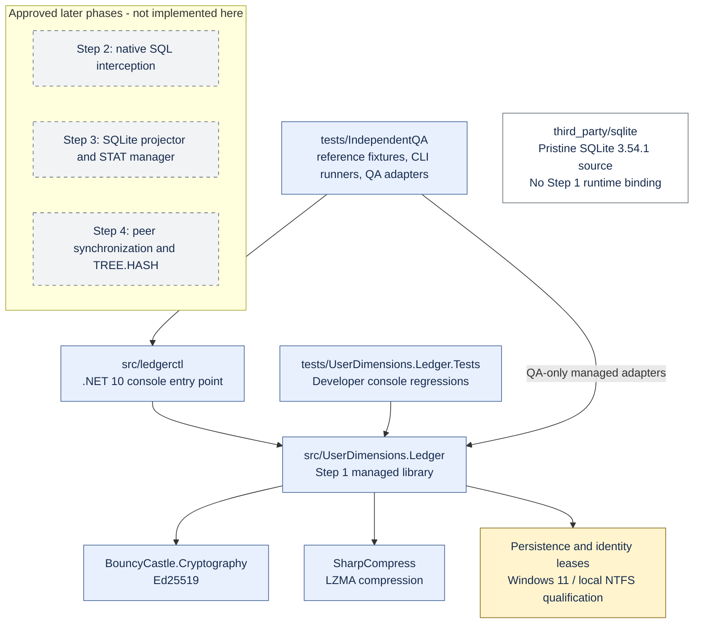
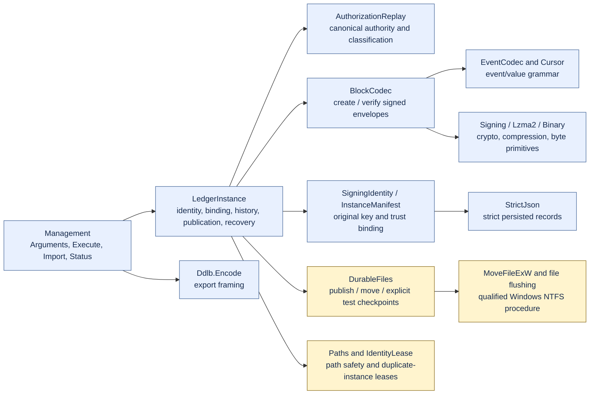
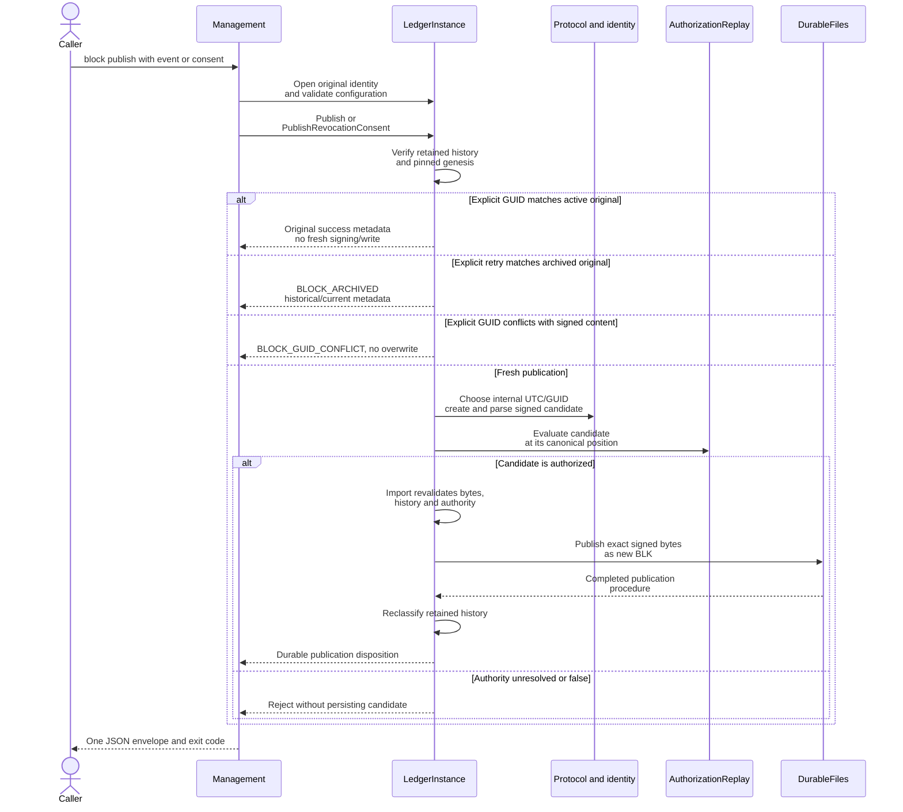
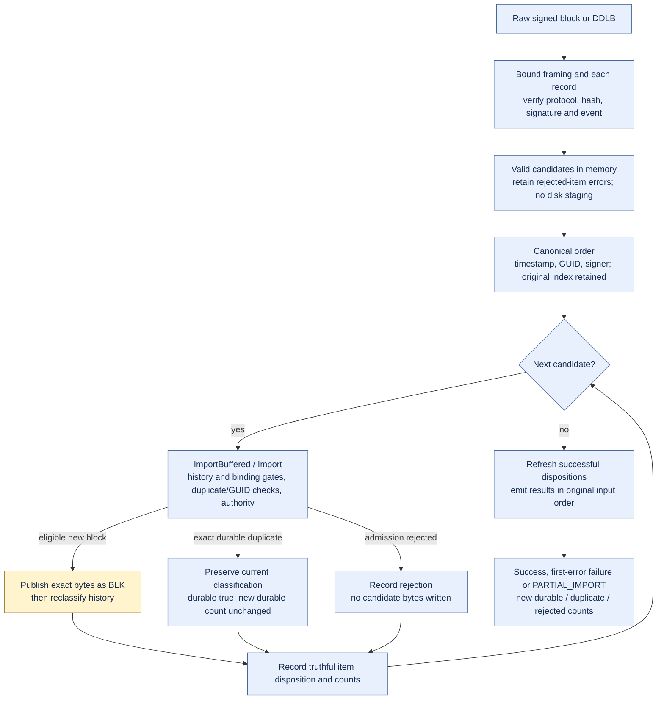
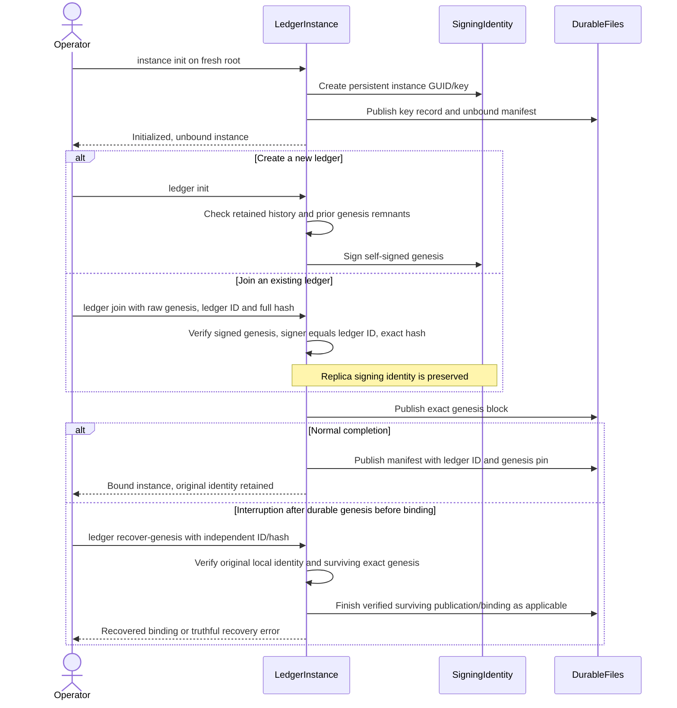
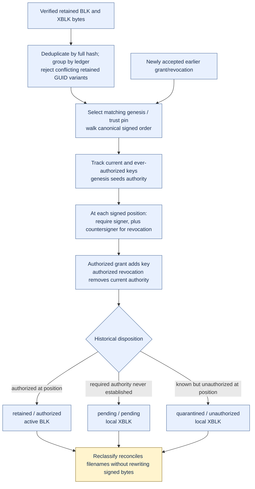
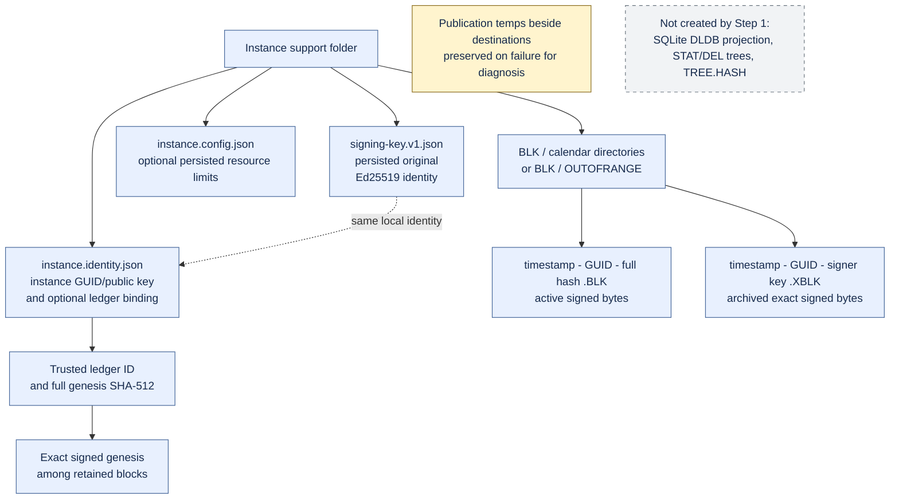
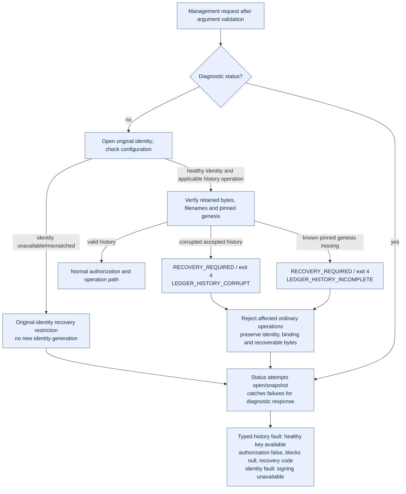

# Step 1 implementation diagrams

Developer-owned, source-backed documentation — 2026-11-18. These diagrams explain
the implementation; they do not amend the protocol or approved architecture.

| Revision | Meaning |
| --- | --- |
| `fbb38781faa29eb5cead9de3dcda0e760b63c7a1` | Immutable accepted Step 1 production baseline |
| `83cbcb5ec7933d1d83cb61a9712353c169ba7788` | Exact code documented here: QA-017-verified, Owner-authorized behavior-preserving maintenance successor |

The [maintenance review](STEP1_MAINTAINABILITY_REVIEW_20261118.md) records the
successor's limited changes and verification. Its implementation paths are the
same as the accepted baseline; the original accepted milestone remains immutable.
The [integration record](STEP1_FOLLOWUP_INTEGRATION_20261118.md) records subsequent
Owner authorization and independent QA-017 verification.
The diagrams' documentation commit is separate from that code-maintenance commit.

The [Technical Design](../../Database_Distributed_Ledger_Technical_Design.md),
[Management API](../../Distributed_Ledger_Management_API_Specification.md) and
[SQLite Plan](../../SQLite_Architecture_and_Implementation_Plan.md) remain the
authorities for contracts. This guide deliberately omits wire-byte definitions.

## 1. Codebase architecture

Blue boxes are implemented managed components. Amber identifies qualified
platform functionality. White identifies vendored source outside the Step 1
runtime. Grey dashed boxes are approved later-phase work, not completed runtime
components. Tests invoke the implementation but are not
production dependencies.

The three solution projects are the CLI, library and Developer regressions. SQLite
is vendored but is not a project reference, native binding or SQL execution path
in Step 1. The source table below identifies the actual classes behind the library.

Sources: [solution](../../UserDimensions.Ledger.slnx),
[CLI entry point](../../src/ledgerctl/Program.cs),
[library dependencies](../../src/UserDimensions.Ledger/UserDimensions.Ledger.csproj),
[SQLite provenance](../upstream/SQLITE_PROVENANCE.md).

## 2. Component responsibilities and calls

The management layer owns argument parsing, dispatch and import-result envelopes.
`LedgerInstance` owns ledger operations and calls the protocol, replay, identity
and persistence components. There is no SQL engine or peer service hidden behind
the management commands.

Amber does not mean every statement is Windows-only: path checks and managed I/O
are shared, but platform policy and qualification constrain them. Initialization
currently requires Windows and fixed NTFS; `DurableFiles.Move` refuses unqualified
platform publication. Its backend is concrete, not a pluggable interface.
`IdentityLease` uses an OS-aware named mutex. Core formats, cryptography and replay
are managed/portable; Linux/macOS storage and locking remain unqualified.

| Source | Main implementation responsibilities |
| --- | --- |
| [Management.cs](../../src/UserDimensions.Ledger/Management.cs) | CLI/API envelopes, parser, finite dispatch, inline raw/DDLB reader, batch accounting, diagnostics |
| [LedgerInstance.cs](../../src/UserDimensions.Ledger/LedgerInstance.cs) | `Inventory`, `Import`, `PublishCore`, `Reclassify`, genesis/binding, configuration, retrieval/export selection, identity recovery; also `Ddlb.Encode` |
| [Authorization.cs](../../src/UserDimensions.Ledger/Authorization.cs) | `AuthorizationReplay.Evaluate`, `BlockDisposition`, `AuthorizationSnapshot` |
| [Protocol.cs](../../src/UserDimensions.Ledger/Protocol.cs) | `BlockCodec`, `EventCodec`, `Cursor`, `Signing`, `Lzma2`, `Binary`, limits and ledger exceptions |
| [RevocationConsent.cs](../../src/UserDimensions.Ledger/RevocationConsent.cs) | consent parsing, signature/role checks and checked signed-time interval |
| [Persistence.cs](../../src/UserDimensions.Ledger/Persistence.cs) | `DurableFiles`, `Paths`, `StrictJson`, `InstanceManifest`, `SigningIdentity`, `IdentityLease` |

`Ddlb` is an encoder, not an import service: incoming DDLB parsing lives inside
`Management.Import`. QA checkpoints require explicit injected dependencies; normal
CLI execution supplies no callbacks or environment-variable fault switch.

## 3. Block lifecycle

### 3a. Local publication and explicit retries

Retained-history verification precedes any fresh block signing, including calls
without an explicit GUID. Fresh signing precedes the candidate's position-specific
authorization evaluation; an unauthorized candidate remains only in memory.

For revocation publication, `PublishConsent` verifies the supplied countersigned
package and checks the existing publication before fresh UTC/consent-expiry work;
fresh publication then uses the common gated path. `BLOCK_ARCHIVED` never restores
an archive or restamps/re-signs it. A durability/classification failure can retain
original bytes and report uncertainty rather than claim success.

Sources: [LedgerInstance.cs](../../src/UserDimensions.Ledger/LedgerInstance.cs)
(`Publish`, `PublishCore`, `ExistingPublication`, `PublishConsent`, `Import`),
[Management.cs](../../src/UserDimensions.Ledger/Management.cs) (`Execute`).

### 3b. Incoming blocks and DDLB batches

Incoming bytes are authenticated and bounded in memory. Valid batch candidates
are processed canonically, while results retain their original transport indices.
One malformed item does not erase independently durable successes.

I/O/durability interruption stops subsequent new persistence; remaining items are
reported accordingly, and already durable receipts survive. A grant must become
durable before its dependent candidate is admitted. Batch import is not atomic
as a group. Exact archived duplicates stay `.XBLK`: they do not count as newly
persisted blocks or become exportable. New unauthorized/unresolved input is
rejected, not directly saved as an archive.

Sources: [Management.cs](../../src/UserDimensions.Ledger/Management.cs) (`Import`,
`ReadItem`, `ImportResult`), [LedgerInstance.cs](../../src/UserDimensions.Ledger/LedgerInstance.cs)
(`ImportBuffered`, `Import`, `RequireIncomingAuthority`).

## 4. Identity and genesis trust lifecycle

Instance identity and ledger identity are different concepts. A joining replica
keeps its own key; the genesis signer identifies the ledger. Both creation and
joining durably retain the exact genesis before publishing the manifest binding.

`instance recover`/`key restore` are explicit original-identity recovery paths;
they do not create replacement identities. Key-only interrupted initialization
requires the existing explicit unbound-initialization confirmation and conflict
checks. `recover-genesis` finalizes verified surviving genesis/binding evidence;
it is not general missing-history repair or network retrieval.

Sources: [LedgerInstance.cs](../../src/UserDimensions.Ledger/LedgerInstance.cs)
(`Initialize`, `InitializeLedger`, `Join`, `Bind`, `RecoverGenesis`, `Recover`),
[Persistence.cs](../../src/UserDimensions.Ledger/Persistence.cs)
(`SigningIdentity`, `InstanceManifest`).

## 5. Authorization and late-arriving history

Replay reads both active and archived retained signed records. It separates
authority at a block's signed position from keys ever authorized in the known
history; this distinction determines pending versus quarantined classification.

Earlier evidence can turn a formerly accepted `.BLK` into `.XBLK`; later sufficient
authority can restore the original `.XBLK` to `.BLK`. No new signature is created.
This classification of previously accepted records does not authorize retention
of new invalid/unresolved input. Conflicting genesis evidence is separately
rejected/classified by the existing gates; there is no implemented GUID arbitration.

`SignedBlock.Ordered` uses timestamp, raw GUID and signer, with full hash as a final
deterministic tie-break; conflicting retained GUID variants already fail the
accepted-history conflict check. This is authorization replay, not SQLite row/schema
projection. Sources: [Authorization.cs](../../src/UserDimensions.Ledger/Authorization.cs),
[Protocol.cs](../../src/UserDimensions.Ledger/Protocol.cs) (`SignedBlock.Ordered`),
[LedgerInstance.cs](../../src/UserDimensions.Ledger/LedgerInstance.cs) (`Reclassify`).

## 6. Actual storage layout and relationships

The CLI receives an absolute support-folder path through `--instance-root`.
Identity and configuration records are separate from the signed ledger files.
An absent optional configuration selects defaults; successful explicit configuration
updates publish a complete replacement record.

The layout labels abbreviate filenames; use `BlockPath` and the authoritative
specification for exact grammar. An archive's filename uses the signer public key,
not the full signed-block hash; verification recovers the latter from exact bytes.
Raw signed records do not carry mutable local classification flags.

There is no `.DLID`, separate persisted recovery-mode flag or Step 1 `.STAT` cache.
The code checks sibling `.DLDB` evidence for initialization/recovery safety but
does not create or project that database. Publication file/directory temps may be
beside the destination folder; they are not a new accepted-history format.
`block get` and DDLB export exclude archived records. Retained counts include active
plus pending/quarantined archives; disputed and opaque counts remain zero.

Sources: [LedgerInstance.cs](../../src/UserDimensions.Ledger/LedgerInstance.cs)
(`BlockPath`, `Configure`, `Get`, `SelectExport`),
[Persistence.cs](../../src/UserDimensions.Ledger/Persistence.cs)
(`DurableFiles`, `InstanceManifest`, `SigningIdentity`). No secret or real test key
material is included in this guide.

## 7. Recovery gates and diagnostic availability

History-dependent operations verify original identity, configuration and retained
history before relying on authority or acknowledging publication/export. The graph
focuses on the distinct identity and typed history failures, not every exit-code
precedence rule.

`status` and `instance status` return diagnostic JSON with exit 0 when they can
report the restricted condition. The condition is re-established by verification;
there is no separately persisted recovery state. Resource/time limits and I/O
failures retain their own diagnostics rather than being universally labeled
history corruption. Malformed **new supplied input** retains its framing/hash/
signature error; it is not relabeled as damaged accepted history.

**A healthy `Snapshot()` is not a pure read:** it calls `Reclassify`, which can
rename retained files when canonical authority changes. For typed impaired-history
failures, `Inventory` throws before that reconciliation, and status preserves
healthy original-key availability while withholding unreliable authority/counts.
Diagnostic fallback is best-effort for other failure categories.

`DurableFiles` writes and flushes temporary bytes before Windows rename publication;
no-overwrite failures preserve existing records, and uncertain completion is
reported. This describes the qualified software procedure, not proof of physical
power-loss survival. Step 1 has explicit original-identity/genesis-binding recovery
but no automatic peer repair of missing/corrupt history; that remains Step 4.

Sources: [LedgerInstance.cs](../../src/UserDimensions.Ledger/LedgerInstance.cs)
(`Open`, `Inventory`, `Snapshot`, `RecoverGenesis`, `Recover`),
[Management.cs](../../src/UserDimensions.Ledger/Management.cs) (`OpenForOperation`,
`Status`), [Persistence.cs](../../src/UserDimensions.Ledger/Persistence.cs)
(`DurableFiles`).

## Reading and maintaining the diagrams

The eight diagrams cover seven topics; publication and incoming transport are
split because their signing, admission and retry paths differ. Source references
are relative to this repository and describe the exact candidate above. Update
the revision note and recheck call order when implementation changes; do not
silently turn planned phases into implemented components.

They use fenced Mermaid flowcharts and sequence diagrams, following
[GitHub's Mermaid documentation](https://docs.github.com/en/get-started/writing-on-github/working-with-advanced-formatting/creating-diagrams).
No plugin-specific directives, interactive scripts or generated diagrams are
required in the repository. All eight diagrams were parsed, rendered and visually
checked locally with Mermaid 10.9.5 in headless Chrome; the original 28 relative
document links were verified, along with the later integration-record link.
GitHub's own renderer/theme was not previewed, so its exact
appearance remains subject to review. No production rebuild or regression rerun
was needed for these documentation-only changes. The diagram contents are unchanged
by the Owner-authorized integration.
