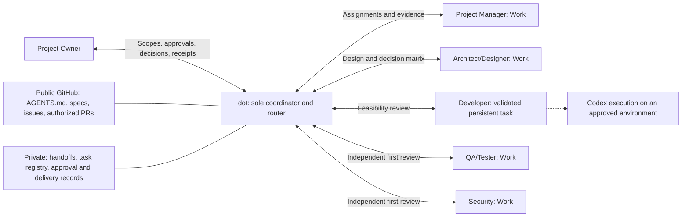
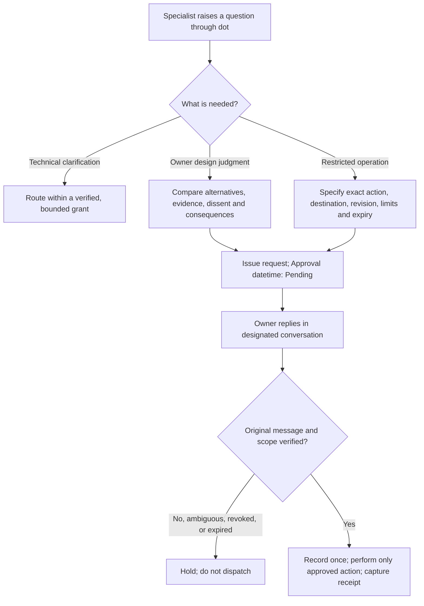
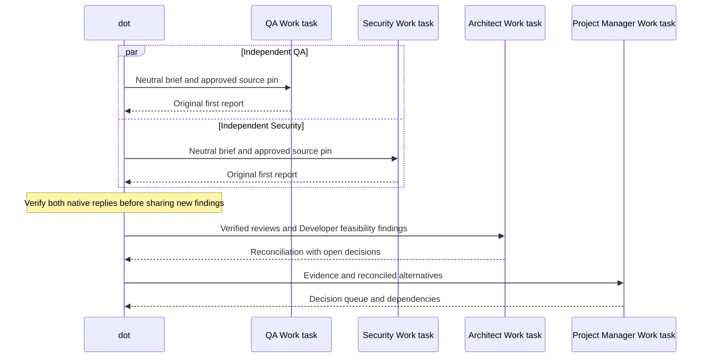

# UDDL AI Coordination Runbook

**Status:** Revised review draft. This manual describes operations. It grants no access, approval, or authority to execute work. Repository `AGENTS.md`, pinned specifications, and verified Project Owner decisions govern when they conflict with this draft.

**Review update:** 2026-11-24 — proposed operational revisions from the November 23–24 L5 and Step 2 specialist coordination rounds. This is a candidate runbook revision, not a repository edit, a live grant, or acceptance of any design. Do not treat examples, past approvals, or historical incident states as current authorization.

**Revision focus:** Immutable verified-file exchanges; recovery from missing delivery receipts and shared-browser contention; QA/Security independence; separate assignment and message counters; cross-specification closeout evidence; and explicit distinction between established Owner requirements and incomplete technical contracts.

## 1. Responsibilities and shared resources



- **Owner:** Defines scope and approves consequential actions in the designated Owner-to-dot conversation. Only the Owner accepts the work or decides open design choices.
- **dot:** Issues request IDs, verifies original approvals, routes all specialist traffic, checks original replies, and maintains the private registry. Workers do not message each other directly.
- **Project Manager:** Consolidates dependencies, alternatives, disagreements, and decisions. Does not turn every technical question into an approval request.
- **Architect:** Maintains the decision matrix, leads design, and reconciles specialist findings. Distinguishes approved behavior from proposals.
- **Developer:** Evaluates feasibility against the pinned sources. A working Codex executor does not become the Developer simply by responding to a pilot. Designation requires explicit scope and validation; implementation requires separate approval.
- **QA** defines observable behavior and acceptance evidence. **Security** reviews trust boundaries, failure handling, and defensive controls. Each produces an independent initial report before seeing other new findings. Preserve dissent in the consolidated record.

**Public repository:** Governance, authoritative specifications, design trackers, and approved publication artifacts. **Private workspace:** Full handoffs, approved recipient/task registry, raw approvals, receipts, working evidence, and machine details. Never put private operational data in a public issue, PR, or this runbook. Keep task IDs and personal account details in the private registry. Handoffs record historical context; they are not live state or authority.

**Local design staging:** When an approved local worker can access it, use the repository-relative `local-notes/temp/` (verify that staging is excluded from tracked changes) for **temporary complete review artifacts**, subject to the authorization and filesystem preflight below. Resolve the absolute path from the private local profile rather than publishing a personal Windows path here. Staging is neither an authoritative specification directory nor a substitute for the private approval/receipt registry. Files staged locally must not be assumed accessible to cloud Work tasks. Keep sensitive or private data out of public artifacts; location under `local-notes/` is not itself a confidentiality guarantee.

## 2. Replacement Windows laptop

### Before installing

- Locate the approved repository, current source revision, private handoff backup, and the existing Owner-to-dot conversation. Do not clone or recreate workers merely because the machine changed.
- Identify the Windows account and the ChatGPT/GitHub accounts with access. Preserve access through the supported account recovery mechanisms. Do not copy credentials, device tokens, SSH keys, or connector data through the runbook.
- Record versions and capability checks in a private local profile. If the old laptop still exists, pause new dispatch from it before using the replacement; maintain one active Coordinator.

### Install and connect in order

1. **ChatGPT desktop and dot.** Get the official [ChatGPT desktop app](https://chatgpt.com/download/) for Windows. Sign in to the account that owns the existing dot. Open the designated Owner-to-dot conversation, not a specialist chat. In the dot profile, look under **Computers** and follow the supported desktop connection flow. Verify the correct computer is connected and selected before relying on local access. Keep the machine online with ChatGPT open for local Work execution. If the control is absent, check account/workspace entitlement and current client version rather than creating another dot. [Connected computers](https://learn.chatgpt.com/docs/dots/computers-and-apps).
2. **Work.** Open a known existing worker from the project’s private registry. Compare the persistent ID and original notes or a previously recorded receipt. Verify the task opens and that you can inspect its history, Activity, and Outputs where available. A history read is not proof of send support. No handshake or test message unless covered by the current approval. Record whether the conversation is Work with a local executor, cloud Work, or standalone Codex; these are not interchangeable. [Task routes](https://learn.chatgpt.com/docs/dots/tasks-and-memory).
3. **Codex.** Open the supported Codex experience, confirm the correct account and executor, and verify the exact existing task or workspace before sending. Only install CLI if the project actually needs it; follow the [official Codex CLI setup](https://developers.openai.com/codex/cli) and confirm `codex --version` from a fresh PowerShell session. CLI existence is not proof that its daemon can contact a desktop task. The standalone desktop conversation and the established Developer Work task must remain separate registry entries.
4. **Git and checkout.** Install [Git for Windows](https://git-scm.com/install/windows) using the official installer for the machine’s architecture. Open a fresh non-admin PowerShell and confirm `git --version`. Restore or clone the intended repository only under an approved setup. Keep private handoffs outside tracked content and restore them separately. Before any engineering action, verify the checkout in ordinary PowerShell and, if relevant, repeat the same read-only preflight from the actual worker environment. Do not fetch, update branch state, or repair in a preflight.

```powershell
$repo = '<approved local checkout root>'
git --no-optional-locks -C $repo rev-parse --show-toplevel
git --no-optional-locks -C $repo rev-parse --absolute-git-dir
git --no-optional-locks -C $repo rev-parse --git-common-dir
git --no-optional-locks -C $repo rev-parse --verify HEAD
git --no-optional-locks -C $repo status --porcelain=v1 -b --untracked-files=all
```

   Stop on a nonzero exit. Compare the root, metadata locations, revision, and status to the private profile and approval. A mismatch or unexpected worktree change is a reason to stop, not a reason to reset. If the checkout was restored as a partial clone, avoid operations that may fetch missing objects without authorization.

5. **GitHub and connectors.** Sign in to GitHub in the normal browser. Separately connect the GitHub plugin in ChatGPT under **Settings → Plugins** (labels may change). Select only the intended repository in the GitHub installation and verify the account/repository pairing with a read-only fetch of root `AGENTS.md` at a known SHA and a read of an existing issue. A browser login, connector login, and local Git credentials prove different access. Do not assume they authorize writes. For Library, verify a known private, non-secret file can be opened from the right account and, if needed, read in the consuming executor. Do not copy the private folder to a connector. [GitHub connection guide](https://help.openai.com/en/articles/11145903-connecting-github-to-chatgpt).
6. **Initialize only missing or approved replacement workers.** Confirm old task IDs and keep old histories. Provide the full role export, baseline, handoff review, manifest, and repository pin. Compare all expected hashes, read all files completely, and verify the matching pinned public documents. After a successful first reply, make one separately scoped same-task continuity check without re-supplying its answers. Record both native turns and replies. Mark PASS only if identity, input integrity, content access, and continuity all match. Do not re-onboard a valid worker just because it moved to a new laptop. Revalidate connection and file access instead.

### Software, connector, and subscription inventory

| Component | Needed for | Cost or entitlement evidence |
|---|---|---|
| Windows and PowerShell | Connected laptop and shell | Existing machine/license; replacement license and hardware costs not verified. |
| ChatGPT desktop, dot, Work and Codex | Owner channel and persistent tasks | Pro was used in UDDL pilots; account/workspace feature access and the minimum suitable plan are not established. As checked November 21, 2026, OpenAI lists [Pro 100, 200, and 500](https://help.openai.com/en/articles/9793128-about-chatgpt-pro-tiers) at USD $100/$200/$500 per month respectively. These are published prices, not a verified invoice, taxes, or renewal quote. Confirm the actual subscription, limits and billing in the account before buying or changing plans. |
| Codex CLI | Optional diagnostics; not the primary route | No separate spend required by this runbook. Confirm any usage charges, credits or API billing before changing sign-in/usage mode. The CLI version exercised in the failed Windows diagnostic was 0.171.0. |
| Git for Windows and editor | Local read-only checks; Markdown review | Git is free/open source. A Mermaid-capable preview is useful; no paid editor is required by this workflow. |
| GitHub repo and ChatGPT GitHub plugin | Public sources and allowed issue reads | GitHub publishes a [Free plan](https://github.com/pricing). Paid GitHub seats, Copilot, CI quotas, and any connector entitlements are separate and not needed to reproduce the read-only review as written. Confirm charges before enabling optional services. |
| ChatGPT Library | Private approved evidence and draft delivery | Availability and limits depend on the account/workspace; no separate charge verified. |
| Private backup storage | Proposed independently restorable registry and handoffs | No provider selected or cost verified. Owner must approve storage, privacy, access, retention, and any cost before adoption. |

**Verified in UDDL pilots:** Same-task follow-ups and native original replies on the registered tasks; Coordinator-mediated PM–Codex messaging without Owner copy/paste; complete Windows handoff reads and hashes; pinned public reads when local Git failed; and a five-role first design round preserving independent QA/Security reviews. A downstream PM could not open some otherwise valid internal report links and correctly labeled its reliance on a Coordinator synopsis. **Documented:** Supported native work routes vary by executor and account; cloud work and local work are distinct. **Untested here:** Full cold-start isolation, automatic handoff of a running turn, reliable messaging to the original standalone Windows Codex conversation, independent registry failover, and broad local checkout writes.

## 3. Approval path and Decision Queue



- **Technical lane:** Specialist questions that can be answered from evidence or resolved within an existing approved design. Assign a named owner and log the answer and sources.
- **Design lane:** Genuine choices with alternatives (including defer where appropriate), consequences, dependencies, recommendation, disagreements, and supporting evidence. Use one formal ID per genuine decision.
- **Restricted-action lane:** Distinct scopes for architecture approval, implementation authorization, publication, merge, milestone acceptance, and release. Add separate approval for new worker creation or repository/file writes where required. Approval of a design, review, or draft never authorizes a later operation.

The single active coordinator issues immutable, globally unique full IDs in `YYYY-MM-DD-EXISTING-REQUEST-ID` form, using the America/Chicago date when formally issued. Check the durable same-day issuance record before assigning an ID; the suffix can recur on a different date. Record creation in ISO 8601 with the applicable Chicago offset. Keep earlier IDs unchanged and history retrievable.

A formal approval package shows **Approval datetime: Pending**. It identifies the exact operations, people or tasks, revision, destination, limits, expiration, and stop conditions. Verify the authenticated original Owner message against that package and check for revocation or supersession before each consequential action. A short reply naming the exact package can suffice. A typed signature, agent message, or forwarded copy cannot grant authority. The first recorder creates one canonical record with Chicago ISO 8601 offset and the original message reference/platform timestamp where available. Display the recorded date and time with CST or CDT; do not ask the Owner to supply it. Later agents reuse the record and verify the original. The timestamp is audit evidence, not proof of authorship or effective time. The register supports auditing; it is not by itself access control.

## 4. Dispatch, review, and receipts

**Mandatory assignment preflight:** Before activating an assignment, identify every required source, intended output and authorized delivery route. Verify on the exact worker task and its actual execution environment that it can read the complete sources and produce the requested deliverables by that route. Check effective session capabilities separately from filesystem permissions; a readable directory or a writable account ACL is not evidence that the worker can write. Use only authorized, bounded read-only evidence. Do not perform unauthorized test writes, change permissions, bypass restrictions, or create extra assignments. If any required capability is unverified, report the specific blocker before dispatch instead of assuming access.



1. Verify the receiver’s persistent task ID, receipt capability, approved revision, and authority. Bound questions, sends, response windows, and history checks to the verified package; observe daily and total caps and expiry. Do not treat caps as quotas.
2. Record an attempt before dispatch. Messages begin `FROM:` and `TO:` and include request ID, unique message ID, parent/message provenance, exact destination ID, revision, read-only scope, and original approval reference. Mark relays as relays, preserve original text and attribution, and do not create side conversations or chains.
3. Record native turn and input IDs, original reply ID and timestamp, delivery state, and final outcome. Prefer native completed status plus original message IDs; correlate any completion marker, but never rely on it alone. Reports end with Findings, Outstanding Issues, Critique, and a request-correlated completion marker.
4. Distinguish **PASS** (verified outcome), **FAIL** (verified mismatch or final error), and **BLOCKED** (missing access, unknown delivery, or unverified response). With stale history, use bounded read-only checks. Never automatically resend an uncertain message. Stop on expiry, revocation, or a material scope change.
5. If a supported Work continuation stays inside its authorization, carry the original request, pin, restrictions, and handoff context. Record and verify both task identities and the original result. Do not create a replacement or move an in-flight turn without authorization. If attribution or scope cannot be established, stop.

**Dated example (November 21, 2026):** The five-role Step 2 grant allowed dot only to relay a technical question and its unchanged reply between named tasks on Issues #1–#3. It allowed up to **10 pairs per America/Chicago calendar day and 150 total over 30 calendar days** from direct approval, after Developer continuity passed. The historical example used one recipient and one reply relay, native receipts, a bounded check budget, no retries or chains, and no new work or writes. It is not standing policy. Check the currently verified grant, its activation/expiry, exact recipients and pin, revocations, and remaining counters before each send or relay. An uncertain attempted pair remains reserved.

### Verified artifact exchange and independent reviews (November 2026 lessons)

**Preferred path, only after verifying actual access and approval:** The author writes a complete, versioned Markdown review artifact to the approved `local-notes/temp/` staging area. New filenames begin `YYYY-MM-DD-` (America/Chicago calendar date), followed by a descriptive identifier and version or unique suffix, for example `2026-11-24-UDDL-STEP2-CONTRACT-v1.md`. Do **not** retroactively rename tracked files or change protocol-defined names. A new version gets a new immutable filename: no overwriting a candidate already distributed for review.

1. Before writing, verify the specific task's filesystem permissions, excluded staging location, source repository pin, scope and write authorization. Write to a private temporary name, finish and flush the entire candidate where appropriate, then finalize it into its versioned name. Do not claim an atomic publish when the filesystem operation has not been qualified. Never modify tracked source or specifications under a design-only grant.
2. The author supplies a manifest: exact filename and relative location, version, repository pin, byte count, SHA-256 of the **raw source bytes**, text encoding, completion marker, immutable candidate ID, and the authorization/request ID. Verify the end marker **and** the entire byte count/digest. End markers and counts alone are insufficient.
3. Dot verifies the raw source candidate and records its manifest privately. QA and Security must independently obtain **the same raw-byte version** before comparing conclusions. A chat-rendered preview, HTML text, excerpt, or successful browser open is not itself proof of byte identity. Literal characters such as `>` may be displayed as `&gt;`; even a few escaped characters change the digest. On mismatch, stop and obtain exact source bytes or reconstruct and independently verify the full digest, with provenance. Never silently accept a visually equivalent copy or "fix" a hash by changing the expected value.
4. Each reviewer must have a separately accessible copy/source and perform an independent first review without the other reviewer's new findings. Avoid sharing one browser-session/tab ownership between concurrent specialist tasks; a tab already held by another session is an access blocker, not proof that a reviewer received or read the document.
5. If a worker lacks direct local filesystem access, send the **entire verified raw document** into the **existing approved worker task** using its supported route. Recheck the received byte count, digest, end marker and candidate ID there. Do not fall back to a shared live browser, partial excerpt, link the worker cannot open, or another worker's unverified summary. If the platform transforms raw bytes, mark the evidence blocked until exact content verification succeeds.
6. Reviewers produce separately attributed, complete findings, linked to the exact candidate ID and source pin. Do not mark QA or Security complete just because a task emitted `COMPLETE`: completion of an access-blocked turn is not a substantive independent review.
7. At closeout, provide Project Manager and Dot the original verified reports whenever possible. If a PM cannot open the reports, label its output as **summary-based**, identify missing originals, preserve dissent and do not claim firsthand verification. Closeout distinguishes corrected clauses, unresolved engineering qualification, open Owner policy decisions, and separately gated official-specification changes.

**Document lifecycle:** A dated staging filename helps locate old drafts but is not a retention or deletion instruction. Remove or archive only after referenced handoffs, approvals, reviews, and evidence-retention obligations have been checked; never discard the sole verifiable source of a decision or review.

### Missing receipts and same-task handoff recovery

A send attempt without a native receipt is **unknown**, not failed. Record that uncertainty and the already-reserved assignment/message budget. Inspect the existing task's native history and the expected staged artifact under a bounded read-only check; distinguish not delivered, delivered but not started, completed, and inconclusive. If a specialist is already running, wait for its exact turn rather than initiate another execution.

- Default: **no automatic resend, duplicate worker, replacement task, or reissued assignment**. A readable linked chat or a manual copy proves at most that it reached that surface; it does not prove the original automated route failed or that the work was authorized to run again.
- If the original delivery cannot be proven unsuccessful, Dot may request a **new, assignment-specific Owner recovery authorization** that explicitly waives that proof requirement. The waiver must be restricted to the **same original worker task and assignment ID**, contingent on verifying that no substantive work or completed artifact already exists, and must forbid duplicate execution. The waiver is not a standing runbook permission and does not expand design or communication limits.
- A manual Owner handoff remains a draft unless its execution is covered by the original grant or a separately verified recovery authorization. If a late original send appears, correlate it to the existing assignment, treat it as a duplicate, and do not execute twice.
- For a review access blocker, use only a recovery allowed by both the underlying assignment and an explicitly active standing delegation, or seek narrow assignment-specific Owner approval. Use the full verified candidate. Receiving a document does not complete a review.
- Record each recovery request, original and replacement transport attempts, native input/turn/reply IDs, source manifest, stop conditions, deadline, explicit Owner waiver and the exact evidence of one execution. A missing receipt is not a reason to reset the accounting or extend the deadline.

### Bounded operational recovery

This procedure grants no authority by itself. A standing delegation is effective only after explicit Owner activation of the exact verified revision. Verify it and the original assignment before each action. The narrower scope controls; a revocation or original deadline stops recovery. Maximum two recovery actions per assignment, or fewer if the assignment says so.

1. **Reconcile first.** Inspect the original task history, native receipts and expected artifacts. Wait for a running turn; use a verified complete result. Resume a stopped task only from a verified checkpoint when the remaining work can be identified without repeating completed steps. Unknown delivery alone never authorizes resending. Correlate any late delivery to the original assignment. If duplicate execution cannot be ruled out, stop automatic recovery and escalate.
2. **Keep the same assignment and task.** Use only an already authorized alternative delivery route or temporary location, exact-byte restoration after a known transport change, or continuation from a verified checkpoint. Verify complete content, byte count and SHA-256 before review. Keep approval evidence separate from peer findings until independent reviews are recorded. Do not change the authorized writer, deliverables, permissions or deadline; do not bypass access controls, add workers or work, make tracked edits, run tests or builds, implement, merge, publish or accept work.
3. **Reserve and report.** Authorized, bounded read-only verification of histories, receipts, artifact integrity, source access and execution capabilities does not consume a recovery action. Reserve and count every actual recovery attempt before execution, even if it fails or returns no receipt. Reconcile before taking another action. Stop and escalate when the limit is reached or scope, integrity, permissions, independence or nonduplication cannot be established. Report routine recoveries in Coordination Status rather than requesting separate approval.

### Distinguish budgets, assignments, and acceptance

**Communication pairs** (including dated daily/30-day caps) and **specialist assignments** are distinct authorization classes. A low communication count does not permit a new specialist design assignment; an assignment reserved by a previous grant is not an unreserved new slot. Track attempted, reserved, active, completed, blocked and expired **by exact grant and worker**; show the date/time with the Chicago offset. A historical cap is not a current entitlement.

An accepted handoff, a completed worker turn, a verified artifact, an independent review, a PM closeout, an Owner design decision, an official specification change, an implementation, a test run and milestone acceptance are **separate states**. Do not advance one from evidence for another. After design reviews, present a requested cross-document integration map (e.g. Technical Design / Management API / SQLite Plan), identify the owning clauses, distinguish policy choices from engineering qualifications and solicit only genuine outstanding Owner decisions. Design-only scope does not silently authorize new assignments, tracked writes, tests, builds, publication or acceptance.

**Historical incidents, not standing authority:** During the November 23–24, 2026 rounds, an Architect recovery used an explicit Owner waiver to activate a manually delivered assignment in the original task; later QA and Security handoffs also required same-task recovery. A concurrent shared browser caused a Security read failure. In a subsequent independent review, a chat-formatted QA candidate differed from the verified Markdown by escaped characters (including `&gt;`) and was correctly rejected until exact bytes could be verified. These events establish operational failure modes, not guaranteed platform behavior or permission to retry automatically.


## 5. Startup, pause, shutdown, reboot, and recovery

### Startup checklist

- [ ] Open the correct Owner channel; read any new instructions, pause orders, revocations, and scope changes.
- [ ] Load the last private checkpoint. Verify the designated Coordinator, registry revision, source pin, exact task IDs and executor identity. Confirm the intended machine is online when required.
- [ ] Reconcile all nonterminal turns before any new dispatch. If history is stale, use only the permitted bounded checks.

- [ ] Reconcile any shared-browser ownership collision, unverified artifact digest, prior handoff recovery waiver, or pending independent review before dispatching a successor assignment. See Section 4's verified-artifact and recovery procedures.
- [ ] Recompute the Chicago calendar day, grant expiry, reserved/used daily and total pairs, and each outstanding response deadline from scope and receipts. Never reset a cumulative count on reboot.
- [ ] Check required file reads and exact revision. Record who did preflight, the time, and any blocker. Start only covered operations whose attempt record is not already reserved.

### Pause, shutdown, or planned reboot

- [ ] Stop new dispatches; do not treat pause as cancellation. Record each task/turn/input ID, authorization and deadline, latest status, reserved counts, remaining checks, and any unresolved reply.
- [ ] Tell the Owner which Windows-executed turns might be interrupted and which cloud turns may finish independently. If waiting for a local turn, keep the app open and machine awake until it finishes or Owner chooses otherwise.
- [ ] Capture a consistent checkpoint and verify its integrity before shutdown where possible. Record timestamp and backup reference. If not possible, record the last known good checkpoint and mark the later interval uncertain.
- [ ] Reboot or shut down only as separately authorized. Do not interrupt an active task, migrate it, or issue a second send to preserve speed.

### Reconnect or recover after an unexpected outage

- [ ] Reopen Windows ChatGPT on the correct account; verify agreement between connected computer, expected task ID/executor, pinned repository, active Owner channel, and private profile.
- [ ] Restore the last verified registry checkpoint if needed. Do not treat its unattempted state as proof nothing was sent after backup. Reconcile from native input/turn/reply IDs, approvals and revocation history before dispatch.
- [ ] **Completed:** Treat it as consumed. **Expired/revoked:** Stop. **Uncertain delivery:** Keep its reservation, verify read-only within scope, and never auto-resend. **Unattempted:** Continue only when positively known to be unattempted and still authorized. **Cloud still running:** Observe the exact turn; do not assume local shutdown cancelled it.
- [ ] Verify receipt linkage and counters, then remove the pause only under the approved scope. If evidence is unavailable or contradictory, retain the block and refer the specific missing evidence to the Owner.

### Troubleshooting guide

| Symptom | Safe next check | Stop condition |
|---|---|---|
| Git reports `fatal: cannot change to …: Permission denied` at `rev-parse`. | Compare the same read-only preflight in ordinary user PowerShell and the approved worker shell. Check the exact root and common Git directory. Existing successful handoff file reads do not prove Git can enter the root. | Do not infer an ACL cause, add a broad safe-directory rule, elevate, change permissions, or write without verifiable status. Use an approved pinned public read or private downloadable runbook when scope permits. |
| Codex CLI runs but `codex app-server daemon version` fails on `app-server-control.sock`, Windows OS error 10050. | Record CLI version, exact error and executor; inspect connection status and whether the expected native task’s history is readable. A help screen is not a connectivity test. | Do not start or change daemon/network settings, run queue delivery, guess an ID, or create another task as a fallback. Prefer the already validated Work route when authorized. |
| Standalone or older task shows “Failed to resume chat” or “Model unavailable.” | Read its exact existing history, confirm task type, connected computer, same account, and model availability. Compare native task link versus copied deep link; another user’s or worker’s access is not implied. | No silent replacement, direct queue send, or claim of delivery from apparent readability. Mark BLOCKED and maintain the old history. |
| Task admitted but response missing or link redirects. | Use native IDs and bounded history reads; check the exact existing task and candidate manifest. A delayed page, completion marker, or readable manual copy alone is not a receipt. For a permitted review handoff, deliver full verified raw content, not merely an excerpt. | Stop on expired window, missing identity linkage, uncertain delivery, or absent narrowly scoped recovery approval. Never repeat a turn automatically. Label any synthesis relying on a synopsis rather than the original. |
| Shared browser/tab reports another session owns it. | Retry read-only in the original task if permitted; otherwise use an approved independent local-file read or full verified existing-task delivery. | No shared-tab takeover, duplicate assignment, or claim of independent review from a failed access attempt. |
| File looks correct but its byte count or SHA-256 differs. | Compare original source bytes and candidate/version metadata. Check whether the transport escaped text such as `>` to `&gt;`; verify exact recovered bytes and final marker before reviewing. | Do not review or sign off on mismatched text, excerpts, or hash changes chosen to force a match. |
| Assignment shows `COMPLETE` but says draft was inaccessible. | Inspect the original completion disposition and evidence of full content access. Recover within an existing task only under the applicable specific Owner authorization. | A finished access-blocked turn is not a completed substantive review. |

## 6. Replacement workers and cold-start rehearsal

Onboard only after approval. Keep each original conversation intact. Provide the replacement’s full role handoff, shared baseline, handoff review and manifest, current root `AGENTS.md`, and relevant pinned specs. Verify access to complete bytes, SHA-256 against expected hashes (match by hash when filenames differ), source revision, and manifest identity. Require one hint-free continuity check on the same task before assigning routine work. Afterward use current approved specifications, decisions, and task checkpoints; reopen handoffs as historical evidence when needed. Keep QA and Security initial reviews independent.

**Proposed recovery test (not verified or authorized by this manual):** Use a separately approved isolated read-only rehearsal with only the intended checkpoint and known source data. Demonstrate actual isolation or mark BLOCKED. Given completed, expired, and uncertain sample operations, recover exact IDs and dates, consume completed work without repetition, stop expired work, and avoid duplicate sends when delivery is uncertain. Verify the output in its original task and compare against known receipts. No live sends or repository changes during the rehearsal.

## 7. Project and publication checklist

Step 1 remains accepted. Step 2 is design/research only. Use [Issue #1](https://github.com/AnthonyCOlsen/DatabaseDistributedLedger/issues/1) for GUID identity and collisions, [Issue #2](https://github.com/AnthonyCOlsen/DatabaseDistributedLedger/issues/2) for partial COMMIT and restart outcomes, and [Issue #3](https://github.com/AnthonyCOlsen/DatabaseDistributedLedger/issues/3) for the IPC contract. Steps 3 and 4 remain future planning. The decision queue and a specialist recommendation never grant implementation permission.

### Dated design-decision context (not a technical specification)

As of the November 24, 2026 Owner instructions, Step 2 design coordination must **track**, without implementing or silently rewriting the official specifications: Option A (COMMIT success after all required durable block publications); stable event/block GUIDs and immutable signed bytes; separate immutable transaction intents and an append-only progress journal as an approved design direction; an explicitly qualified durable `.lock`/ready-state boundary; local independent multi-master publication; a 10-second default for **ordinary relational projection delay** without delaying canonical master grants/revocations; no partial database visibility during replay; and caller-visible projection/suppression outcomes. Frozen, partially applicable events preserve original signed history while the projector applies independently valid portions, subject to verifying the protocol representation. The Owner accepts the late-history tradeoff for suppression of wholly obsolete **unsigned, pre-irrevocable** changes using a consistent available projection. The Ledger Service and Step 2 must still function without mandatory Step 3 projection.

These are a **historical coordination snapshot**, not a substitute for the exact authenticated Owner messages, implementation-qualified design, or protocol documents. Exact C3 irrevocability, SQLite caller interruption codes and lifecycle, authenticated journal compaction/recovery, and per-signature authority synchronization were subject to independent specialist qualification in the November 24 closure round. Cleanup A/B, release E/T, restore guarantees and retention choices must not be silently selected. Resolve competing technical statements from the canonical approved evidence/decision register, not from this runbook. Escalate any required wire-protocol change rather than assuming that partial projection is already representable.


The eventual home is `docs/operations/UDDL_AI_COORDINATION_RUNBOOK.md`. Review this draft, scan for private data, and preview the fenced diagrams in a Mermaid-capable Markdown viewer. [GitHub Mermaid documentation](https://docs.github.com/en/get-started/writing-on-github/working-with-advanced-formatting/creating-diagrams). Verify only the intended file and exact reviewed bytes are proposed for publication. Keep publication and merge separately authorized; no approval is inferred from receiving or reviewing this draft.

## 8. Durable coordination registry and verification plan

**Current and demonstrated:** The Coordinator maintains private request records, approval references, role/task IDs, attempt reservations, counters and receipts; native histories were checked for selected pilot results. These records are useful audit evidence. They are not an independently qualified database, automatic backup, access-control service, or guarantee of atomic dispatch.

**Required, not yet implemented or qualified:** One private durable registry with one active writer, versioned schema, immutable events and derived state. Keep originals retrievable, with redacted audit exports when needed. At minimum record:

- Issuance: immutable request ID, Chicago date and offset, package/revision/destinations, scope digest or version, and links to supersession.
- Authority: authenticated original message location and platform timestamp, canonical first-recorded time, activation conditions, expiry, revocation, and separate gate status.
- Task: role, exact native task ID, executor, acceptance evidence, pin, handoff hashes, original-history reference, and replacement lineage.
- Exchange: original request/reply provenance, parent IDs, source/destination, state, attempt reservation, Chicago-day and total counts, native input/turn/reply IDs, timestamps/deadline, error and verification basis.
- Checkpoint: active Coordinator, schema/version, latest consistent transaction or event sequence, unresolved operations, backup integrity and retention reference.
- Artifact: canonical source candidate ID and version, raw-byte SHA-256, byte count, encoding, end marker, repo pin, owner of file, staging and delivery routes, reviewer-access verification, immutable supersession and retention disposition.
- Standing recovery delegation: separate grant ID, original authenticated Owner approval, verified activation revision and time, phase/assignment exclusions, revocation and supersession history.
- Recovery: underlying grant and original assignment IDs, exact task and artifact references, failure and nonduplication evidence, reserved action number and time, route and timestamps, any specific Owner waiver, native receipts, outcome and integrity evidence, remaining allowance, and which original reviewer report was available downstream. Preserve earlier events and reservations across handoffs and restarts. If the authoritative registry is unavailable, stop automatic recovery.

**Atomicity and recovery requirements:** In one local transaction, reserve the unique operation/message ID, debit or reserve both counters, and append the intent before sending. Update the receipt and state together. Enforce uniqueness and compare-and-set state transitions; a crash cannot clear a reservation. A local transaction does not include the service sending the message. A lost service response is therefore **uncertain** until native evidence resolves it; do not claim exactly-once delivery or retry. Resolve multi-writer contention by pausing, not by replaying.

**Backups:** Project Owner designates a backup steward and approves private encrypted storage and retention. The Coordinator verifies consistent snapshots, schema compatibility, checksums, linkage to original messages, and restore by a person without fresh write permissions. Use an off-device encrypted backup with separately controlled access and document recovery time and acceptable data loss. Never store secrets in the registry or assume “git-ignored” is access control.

**Acceptance drill, separately authorized and no live sends:** Restore a consistent snapshot into an isolated read-only exercise. Simulate competing Coordinator instances, a Chicago date rollover, an interrupted backup, and interruption before reservation, after reservation and after external acceptance but before receipt. Verify completed, expired, revoked and uncertain examples against recorded originals. PASS only if no duplicate IDs, no double counting, no missed revocation, no event loss in a complete backup, no automatic repeat of uncertain work, and reproducible comparison of old and new state. FAIL on contradictions or lost records; BLOCKED if isolation, backup integrity, or original-history access cannot be established. Record the measured restore time and the exact limitations; no live repair under the drill scope.

## 9. Private companion template: UDDL_LOCAL_PROFILE.md

Copy the template below into a separate private location **only when authorized**. Do not commit or publish the filled copy. Use references to approved credential storage, not values. This template is not a second artifact or an authorization.

```markdown
# UDDL Local Profile (PRIVATE)
- Prepared / last verified: <ISO 8601 with offset>
- Owner approval channel reference: <private reference>
- Coordinator and recovery contact: <role / private contact reference>
- Machine alias / OS / connected-executor reference: <values>
- Checkout root / expected remote / branch / reviewed revision: <values>
- Git directory / common directory / permitted workspace: <paths>
- Private handoff directory / manifest digest / backup reference: <values>
- Local staging directory (private absolute path) / last verified manifest: <references>
- Latest immutable review candidate / raw-byte count / SHA-256 / end marker: <references>
- Independent QA and Security access/first-review receipts: <references>
- ChatGPT account/workspace alias and confirmed feature entitlements: <references>
- App, CLI, Git and editor versions / connector status: <values>
- Subscription or receipt reference / next verification: <reference only>
- Verified worker roster (PM, Architect, Developer, QA, Security): <task ID, executor, continuity receipt per role>
- Optional legacy conversation references (not routable): <references>
- Registry location / schema / current checkpoint / active writer: <references>
- Backup steward / encrypted backup reference / last restore drill: <references>
- Current grant references and revocations: <references; do not transcribe secrets>
- Outstanding reservations and recovery notes: <checkpoint references only>
- Current assignment slots versus message-pair counters / expiry: <references>
- Delivery-uncertainty and specific Owner recovery waivers: <references>
- Credential manager location: <reference only; never include credentials>
```
